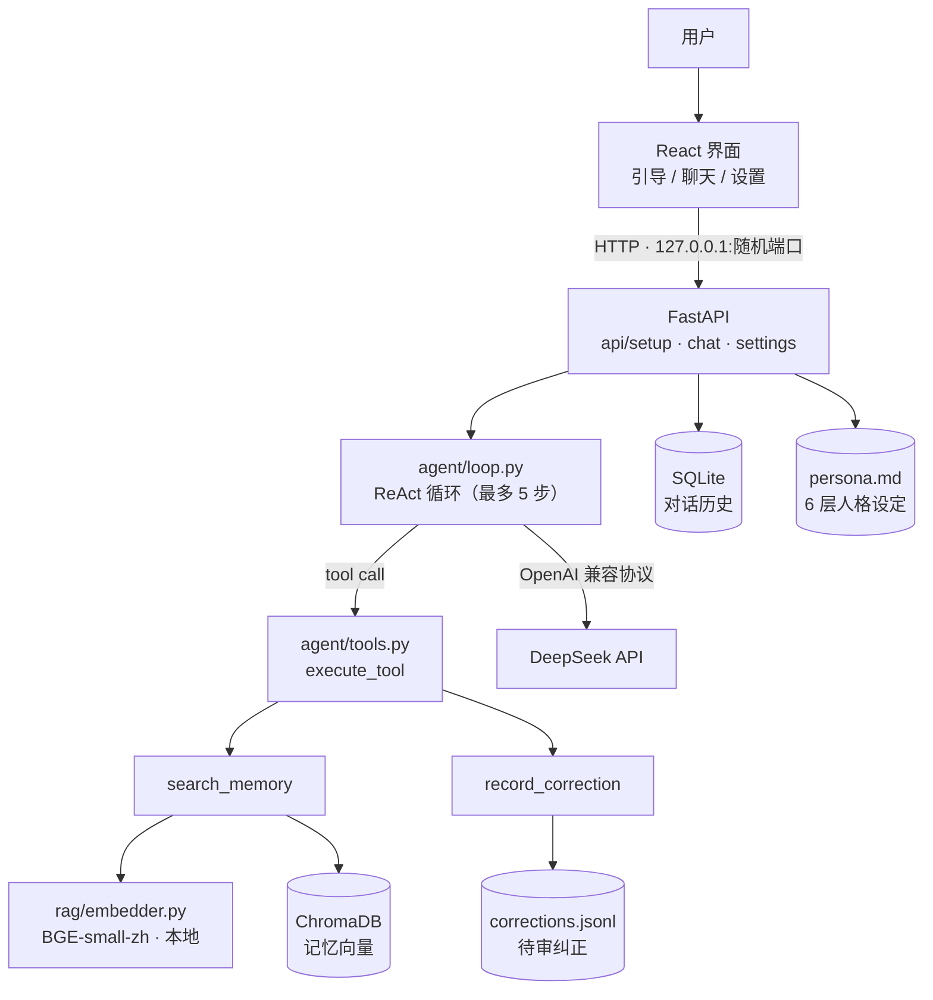

# 重逢 — AI 数字亲人桌面伴侣

让没有任何编程经验的普通人，也能通过导入与已故亲人的聊天记录，生成本地运行的专属 AI 数字亲人，以极简、温润的对话方式寄托思念。

> 🏆 TRAE SOLO Vibecoding 参赛作品

---

> 📐 **README 结构说明**
> 本 README 正按「设计文档」结构重组：问题 → 约束 → 架构 → 度量方式 → 数字 → 取舍 → 下一步。
> **数字部分待步骤 2-8 的实测填充**，现在留 TBD。
> 原始的功能说明和使用方法保留在下方「附录」。

## 1. 问题

让没有任何编程经验的普通人，也能通过导入与已故亲人的聊天记录，
生成本地运行的专属 AI 数字亲人。

## 2. 约束

| 约束 | 对技术选型的影响 |
|------|-----------------|
| 完全本地运行、隐私优先（核心卖点） | 可观测性必须自托管 → Langfuse，**不用 LangSmith**（仅 SaaS） |
| 面向零技术背景用户 | 错误信息必须是中文人话，不暴露堆栈、不用红色错误图标 |
| 单机桌面环境 | 不引入需要外部服务的依赖 |

## 3. 架构



**关键设计：**

- **三层拆分**：`llm.py` 只做协议转换，`tools.py` 只做工具执行，`loop.py` 只做决策流程
- **可测试性**：循环接受注入的 `LLMClient`，56 个测试全部离线运行
- **写操作隔离**：模型不能直接改人格，纠正只追加待审日志

## 4. 怎么度量的

**原则：先建度量，再做优化。** 没有基线时，"改进了"只是感觉。

### 4.1 检索质量

用真实聊天记录构建评估集，不做合成问题：

```
用户真实提问 + 对方的第一条实质回复 → 一条 golden item
```

三条设计纪律：

1. **用真实提问**，不用 LLM 生成 —— 避免分布偏移
2. **用 evidence 文本定位**，不用 chunk id —— 改分块方式后评估集依然有效
3. **用生产同一条管线** —— `extract → chunk → embed → query`，改一处都不算数

指标：`recall@k`（前 k 条里有没有证据）、`MRR`（正确项排第几）。

### 4.2 Agent 行为

三条样例验证工具调用是否符合预期（记忆检索 / 闲聊 / 纠错），见
`backend/scripts/verify_agent.py`。

### 4.3 回归测试

56 个 pytest 用例，覆盖正确性 bug、检索指标、工具层、循环控制流。
循环逻辑通过注入假客户端测试，不需要 API Key 和网络。

## 5. 数字

### 检索质量（36 条 golden set）

| 阶段 | 块数 | recall@1 | recall@5 | MRR |
|---|---|---|---|---|
| 基线（只取对方发言，512/64） | 115 | 0.083 | 0.167 | 0.107 |
| + Contextual Retrieval（512/64） | 205 | 0.139 | 0.250 | 0.186 |
| + 分块降到 256/40 | 456 | **0.194** | **0.333** | **0.237** |

**recall@5 相对提升 99%。** 每一步只改一个变量，收益可归因。

**诊断依据**：83% 的问答对零字面重叠，且原索引只含对方发言 —— 提问中的关键实体
（地点、人名）从未进入索引。这是 Contextual Retrieval 的直接动机。

### 成本与延迟

| 场景 | 模型调用次数 |
|---|---|
| 闲聊（不查记忆） | 1 |
| 需要查记忆 | 2 |
| 模型反复调用工具 | 上限 5 + 1 次收尾 |

改造前：**每条消息固定 2 次**，且分类调用看不到对话历史。

## 6. 取舍

详见 [`docs/decisions/`](docs/decisions/)。已记录的决策：

- [ADR-0002](docs/decisions/0002-guardrail-is-conditional.md) — 记忆约束改为条件式
- [ADR-0003](docs/decisions/0003-explicit-destructive-operations.md) — 破坏性操作必须显式命名
- [ADR-0004](docs/decisions/0004-reunion-home-env-var.md) — 数据目录可重定向
- [ADR-0005](docs/decisions/0005-python-version.md) — Python 锁定 3.13

## 7. 下一步

见[路线图 spec](docs/superpowers/specs/2026-10-11-agent-engineering-roadmap-design.md)与[步骤 1 实现计划](docs/superpowers/plans/2026-10-12-step-1-correctness-bugs.md)。

---

# 附录：功能与使用说明

## 为什么做这个

目前开源社区的 AI 陪伴 Skill（如前任/同事 Skill）多为命令行工具，需要配置 Python 环境、安装依赖、编写 System Prompt。对于从未接触过代码的大众来说，这些门槛是不可逾越的。

「重逢」是一个真正开箱即用的独立桌面软件——完全本地运行，断绝隐私泄露焦虑。用户只需输入 API Key、填写亲人信息、上传聊天记录，就能开始对话。

## 功能

- **5 屏对话式引导**：借鉴 MBTI 问卷思路，每屏只问 2-3 个具体问题，引导用户自然描述亲人
- **dot-skill 人格蒸馏**：基于 15k+ star 开源项目，从聊天记录中提取表达 DNA、情绪触发点、冲突模式、记忆印记
- **本地 RAG 记忆检索**：聊天记录分块 → BGE 向量嵌入 → ChromaDB 存储，对话时检索相关记忆
- **Agent 循环**：模型自主决定调用 `search_memory` / `record_correction`，
  观察结果后继续推理或作答，最多 5 步
- **角色内纠错**：用户纠正 AI 行为时，以角色口吻自然回应，不暴露系统身份
- **温润极简 UI**：暖色调、无技术元素，所有错误提示不出现红色感叹号

## 技术架构

```
Electron 桌面壳
├── React + TypeScript 前端（Vite）
│   ├── 5 屏引导向导
│   ├── 聊天界面（头像 + 气泡 + 输入中状态）
│   └── 设置面板
└── Python FastAPI 后端（子进程）
    ├── dot-skill 人格蒸馏管线
    ├── RAG 引擎（LangChain + BGE + ChromaDB）
    ├── Agent 循环（ReAct 模式）
    └── SQLite 对话存储
```

**技术栈：** Electron · React · TypeScript · Vite · Python · FastAPI · ChromaDB · sentence-transformers (BGE-small-zh-v1.5) · LangChain · SQLite · DeepSeek API

## 前置要求

- **Python 3.9+**（[下载](https://www.python.org/downloads/)）
- **Node.js 22+**（[下载](https://nodejs.org/)）
- **DeepSeek API Key**（[获取](https://platform.deepseek.com/api_keys)）

## 快速开始

### 方式一：自动安装（推荐）

```bash
# 克隆仓库
git clone https://github.com/guiguigui72/reunion.git
cd reunion

# 双击运行
setup.bat
```

### 方式二：手动安装

```bash
git clone https://github.com/guiguigui72/reunion.git
cd reunion

# 安装 Python 依赖
pip install -r backend/requirements.txt

# 安装 Node.js 依赖
npm install

# 启动
npm run electron:dev
```

## 项目结构

```
reunion/
├── electron/              # Electron 主进程
│   ├── main.js            # Python 生命周期管理
│   └── preload.js         # 安全上下文桥接
├── src/                   # React 前端
│   ├── components/        # 组件（Wizard, ChatWindow, SettingsPanel 等）
│   ├── hooks/             # 状态管理（useSetup, useChat）
│   ├── api.ts             # HTTP API 客户端
│   └── App.css            # 温润主题样式
├── backend/               # Python 后端
│   ├── api/               # FastAPI 端点（setup, chat, settings）
│   ├── agent/             # Agent 循环（ReAct + 纠错）
│   ├── persona/           # dot-skill 人格蒸馏 + 纠错处理
│   ├── rag/               # RAG 引擎（分块 + 嵌入 + 检索）
│   ├── chat/              # SQLite 对话存储
│   ├── prompts/           # dot-skill relationship Prompt 文件
│   └── main.py            # FastAPI 入口
└── docs/                  # 设计文档和实现计划
```

## Roadmap

- [x] MVP：Electron 桌面应用 + 5 屏引导 + RAG + dot-skill 蒸馏
- [x] 对话式引导 + 智能追问
- [x] dot-skill 原生 Prompt 对齐
- [ ] 打包为 .exe 安装包（PyInstaller + electron-builder）
- [ ] QQ/微信多渠道支持（OpenClaw 集成）
- [ ] 语音对话

## License

MIT

## 致谢

- [dot-skill](https://github.com/titanwings/colleague-skill) — 人物蒸馏引擎
- [BAAI/bge-small-zh-v1.5](https://huggingface.co/BAAI/bge-small-zh-v1.5) — 中文嵌入模型
- [ChromaDB](https://www.trychroma.com/) — 本地向量数据库
